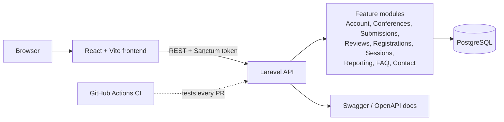

# Conference Management Tool (CMT)

A web platform for running academic conferences end to end: call for papers, author submissions, reviewer assignment and peer review, decisions, registrations, the session programme and reporting.

Built in 2026 by a large team of NWU CMPG323 (IT Developments) students as a real multi-team software project. Project leadership and team coordination were provided by Musawakhe (Wayne) Chipeya as part of ITRI624 Information Systems Engineering 2 (BSc Honours).

| | |
|---|---|
| **Backend** | Laravel 12 (PHP 8.2), PostgreSQL, Laravel Sanctum auth, Swagger/OpenAPI docs, modular feature-driven architecture |
| **Frontend** | React 18, Vite, Tailwind CSS, React Router, Vitest |
| **Delivery** | GitHub pull-request workflow, GitHub Actions CI (backend tests on PostgreSQL), Docker, Vercel, Postman collections |

## Features

- **Roles:** administrators, authors, reviewers and attendees, each with their own dashboard
- **Conferences:** create, edit and browse conferences and their calls for papers
- **Submissions:** authors submit and edit papers and track feedback
- **Reviews:** admins assign reviewers; reviewers score and comment; the review lifecycle runs through to a decision
- **Registrations and sessions:** attendee registration and the conference programme
- **Admin tools:** reports, FAQs, contact messages, testimonials and user management

## Architecture

Each backend module keeps its own controllers, actions, requests, models and policies, so teams could work on separate features with few merge conflicts.

## Getting started

- Backend setup: [backend/README.md](backend/README.md)
- Frontend setup: [frontend/README.md](frontend/README.md)
- API testing: import the collections in `postman/`

## How the project was run

The team was organised into five workstreams with a team leader each:

| Team | Responsibility |
|---|---|
| A | Requirements analysis and UI/UX design |
| B | Database design |
| C | Backend development (Laravel API) |
| D | Frontend development (React) |
| E | Quality assurance and documentation |

Coordination practices that kept the work moving:

- **Team leaders as the communication layer.** Leaders coordinated their own members and reported progress, instead of every student routing through the project lead.
- **Dependency management.** Database and API contracts were agreed early, because backend work depends on the schema and frontend work depends on both the UI design and the API.
- **Pull-request workflow.** Work was merged through feature branches and pull requests (70+ merged), with CI running the backend test suite on pull requests.
- **Clear deliverables and deadlines** per team, reviewed regularly against the overall schedule.

## Contributors

Thanks to everyone in the CMPG323 2026 class who contributed code, design, testing and documentation. See the [contributors graph](https://github.com/Waynemusawakhe/Conference-Management-Tool/graphs/contributors) for the full list.
